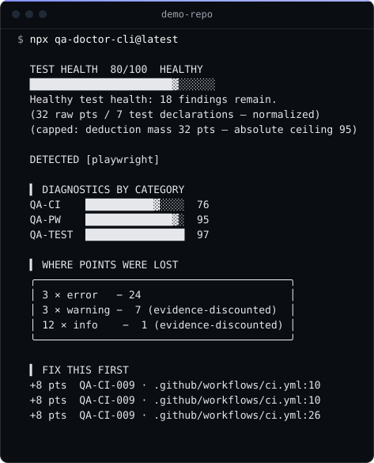

<div align="center">



<br />

**Mjölnir quantifies how much you can trust your CI — and blocks releases when verification isn't earning its keep.**

<br />

[](https://www.npmjs.com/package/mjolnir-qa)
[](https://www.npmjs.com/package/mjolnir-qa)
[](https://github.com/Sergey-Bar/Mjolnir/actions/workflows/ci.yml)
[](https://codecov.io/gh/Sergey-Bar/Mjolnir)
[](LICENSE)
[](https://nodejs.org)

```bash
npx mjolnir-qa@latest
```

Pin it for reproducible CI: `npx mjolnir-qa@6.0.1`. Requires **Node.js ≥ 22.18** on Windows, macOS or Linux.

[**Interactive walkthrough**](https://sergey-bar.github.io/Mjolnir/) · [Docs](https://sergey-bar.github.io/Mjolnir/) · [CHANGELOG](CHANGELOG.md) · [Video](assets/video/mjolnir-demo.mp4)

</div>

---

## Release status

The published line is `6.0.1`, and this working tree is that line. The version table is
[`docs/ROADMAP.yaml`](docs/ROADMAP.yaml). This document does not publish a tag or authorize a release.

---

## The problem: a green check is a claim, not proof

A green check means the pipeline did not fail. It does **not** mean the tests ran, or that they could have failed.

```yaml
# These all ship green. None earned it.
steps:
  - run: npm test || true # exit code swallowed (QA-CI-002)
  - run: npm test | tee test.log # exit code lost without pipefail (QA-CI-009)
```

Mjölnir reads your test suite, your CI workflows, and (when available) the report of a real run. It reports every finding with a **trust level** (L0–L5, where L3+ requires a real run) and a **measured false-positive rate** where corpus evidence exists.

<p align="center">
  
</p>

---

## See it work

A real scan of [`examples/demo-repo`](examples/demo-repo):

<p align="center">
  
</p>

<sub>Generated by `npm run docs:hero` from a real scan and drift-locked in CI. The full `--verbose` report is
[`demo.svg`](assets/readme/demo.svg); the architecture poster is [`architecture.svg`](assets/readme/architecture.svg).</sub>

---

## Quickstart

```bash
# 1. Scan — Trust Report, exits 1 on gate findings
npx mjolnir-qa@latest

# 2. Block in CI — scan only what your branch changed
npx mjolnir-qa@latest --scope changed

# 3. Fix and re-verify — safe auto-fixes, each re-scanned to prove it landed
mjolnir fix
```

**Prove the fix with a baseline, then delta:**

```bash
npx mjolnir-qa@latest --save-baseline   # once: writes .mjolnir/baseline.json
# … make the fix …
mjolnir ci verify                 # RESOLVED (gone) / NEW (introduced)
```

---

## What it catches

**<!-- census:total-rules -->79 rules<!-- /census:total-rules -->** in four families — test hygiene, test quality, Playwright and CI integrity — across TypeScript/JavaScript, Python, Java, C# and GitHub Actions YAML.

| Family           | Example rules                                                                                                                                        |
| ---------------- | ---------------------------------------------------------------------------------------------------------------------------------------------------- |
| **CI integrity** | `\|\| true` swallowing exit codes (`QA-CI-002`), `continue-on-error` on gate jobs (`QA-CI-001`), always-success steps masking failures (`QA-CI-008`) |
| **Test hygiene** | Committed `.only`/`fit` (`QA-TEST-001`), tests with no assertions (`QA-TEST-003`), hard sleeps (`QA-TEST-004`)                                       |
| **Test quality** | Unawaited promise assertions (`QA-TQUAL-009`), tautological assertions (`QA-TQUAL-002`)                                                              |
| **Playwright**   | Unawaited locator assertions (`QA-PW-002`), `page.pause()` committed (`QA-PW-003`), brittle selectors (`QA-PW-004`)                                  |
| **Python**       | Skipped tests (`QA-PY-002`), `time.sleep()` (`QA-PY-005`), tautological assertions (`QA-PY-012`)                                                     |
| **Java / C#**    | Disabled tests, hard sleeps, no assertions, brittle selectors                                                                                        |

Full catalog: `mjolnir explain --list --md` or [what-it-checks](https://sergey-bar.github.io/Mjolnir/guide/what-it-checks). **<!-- census:measured-of-total -->73 of 79<!-- /census:measured-of-total --> rules carry a false-positive rate measured against real OSS code.** The other <!-- census:unmeasured -->6<!-- /census:unmeasured --> ship on the author's estimate and say so on each finding.

<details>
<summary><strong>Every rule named in this README</strong>, in one table</summary>

<br />

> `warn-only` rules run only under `--include-warn` and never gate. The severity shown is the authored severity.

| ID           | Family     | Rule                                                         | Severity | Default scan |
| ------------ | ---------- | ------------------------------------------------------------ | -------- | ------------ |
| QA-TEST-001  | Hygiene    | Focused test committed (`.only`, `fit`)                      | error    | warn-only    |
| QA-TEST-003  | Hygiene    | Test with no assertions                                      | error    | warn-only    |
| QA-TEST-004  | Hygiene    | Hard sleep (`waitForTimeout`, `sleep()`, `delay()`)          | warning  | default      |
| QA-TQUAL-002 | Quality    | Tautological assertion                                       | error    | warn-only    |
| QA-TQUAL-009 | Quality    | Unawaited promise assertion                                  | error    | warn-only    |
| QA-PW-002    | Playwright | Unawaited locator assertion                                  | error    | default      |
| QA-PW-003    | Playwright | `page.pause()` / `test.only()` committed                     | error    | default      |
| QA-PW-004    | Playwright | Brittle CSS/XPath selectors                                  | warning  | warn-only    |
| QA-CI-001    | CI         | `continue-on-error` masks a failing gate                     | error    | warn-only    |
| QA-CI-002    | CI         | `\|\| true` swallows exit codes                              | error    | default      |
| QA-CI-008    | CI         | Always-success step masks failures                           | error    | warn-only    |
| QA-CI-009    | CI         | Exit code not propagated (`\|` without pipefail, `;` chains) | error    | default      |
| QA-PY-002    | Python     | Skipped test (`skip`, non-strict `xfail`)                    | warning  | default      |
| QA-PY-005    | Python     | `time.sleep()` in tests                                      | warning  | default      |
| QA-PY-012    | Python     | Tautological assertion                                       | error    | warn-only    |
| QA-JV-101    | Java       | Disabled test (`@Disabled`)                                  | warning  | default      |
| QA-CS-103    | C#         | Test method with no assertions                               | error    | default      |

</details>

---

## The Worthiness Score

<p align="center">
  
</p>

Severity sets a base deduction (`error −8`, `warning −3`, `info −1`), discounted by evidence level: **E2** (deterministic proof) pays in full, **E1** (pattern) half, **E0** (observation) nothing. Normalized by suite exposure — deductions per test declaration, not per file.

---

## Evidence you can gate on

| Level  | Name                | Means                                              | Deduction |
| ------ | ------------------- | -------------------------------------------------- | --------- |
| **E2** | Deterministic proof | The defect is present in the code as written       | Full      |
| **E1** | Pattern evidence    | A pattern strongly tied to the defect matched      | Half      |
| **E0** | Observation         | Worth knowing. Not a claim that anything is wrong. | Zero      |

Static scans stop at **L2** (proven in code). Give Mjölnir a real run report (Playwright JSON, Jest/Vitest JSON, JUnit XML) and findings lift to **L3–L5** (file ran, test ran, run agrees).

---

## Reference

<details>
<summary><strong>Every command</strong></summary>

<br />

| Command                           | What it does                                            |
| --------------------------------- | ------------------------------------------------------- |
| `mjolnir`                         | Trust Report: verdict, confidence, next action          |
| `mjolnir --scope changed`         | Only what your branch introduced (CI form)              |
| `mjolnir --blocking error`        | Exit 1 on error findings — gate releases                |
| `mjolnir ci install`              | Write the advisory PR workflow (default)                |
| `mjolnir ci install --gate error` | Opt into the blocking PR workflow                       |
| `mjolnir ci verify`               | Delta against `.mjolnir/baseline.json` — RESOLVED / NEW |
| `mjolnir ci release-trust`        | 12-dimension release assurance verdict                  |
| `mjolnir share`                   | One self-contained HTML trust report to hand over       |

| `mjolnir contract-verify --contract <scan.json>` | Verify a persisted machine contract against a scan |

| `mjolnir policy` | Initialize, validate, or check policy gates |
| `mjolnir analyze --cross-file` | Bounded cross-file analysis |
| `mjolnir ci adapters github .` | Generate CI templates for supported providers |

| `mjolnir mcp` | Read-only MCP tools over stdio |
| `mjolnir explain QA-CI-001` | What, why and fix, plus measured/unmeasured state |
| `mjolnir explain <file:line> src/a.spec.ts:42` | Why this exact line was flagged. Never gates. |

| `mjolnir handoff` | Remediation plan for a coding agent |
| `mjolnir --json` / `--format sarif` | Machine-readable output, GitHub Code Scanning |
| `mjolnir --format codequality` | GitLab Code Quality report (MR widget artifact) |
| `mjolnir --include-warn` | Also run WARN-tier rules (higher FP risk) |

<details>
<summary><strong>Every other command</strong> — flake triage, reporting, governance</summary>

<br />

| Command                   | What it does                               |
| ------------------------- | ------------------------------------------ |
| `mjolnir --classic`       | The pre-Trust-Report score banner render   |
| `mjolnir explain verdict` | Why the saved scan's verdict is what it is |

| `mjolnir explain --playwright ./test-results/` | Playwright run summary: retries, flakes, slowest |
| `mjolnir doctor --frameworks` | Playwright-only deep scan plus Selector Health Score |
| `mjolnir fix --dry-run` / `fix` | Safe auto-fixes, each re-scanned to prove it landed |

| `mjolnir scan` | The whole tree. This is the default: bare `mjolnir` is the same command |
| `mjolnir scan --scope changed` | Only what this branch changed — the PR gate |
| `mjolnir scan --format github-summary` | CI annotations and a step summary from a report |
| `mjolnir scan --format pr-comment` | A scoped PR comment, as Markdown |

| `mjolnir explain --plan` | Onboarding map of the suite for a new QA engineer |

| `mjolnir scan --suppressions` | List suppressed findings, for governance |
| `mjolnir ci integrity` | Verify blocking CI scans and suppression policy |
| `mjolnir doctor --frameworks` | Inspect bounded maturity with human calibration |
| `mjolnir suppression-gate` | Enforce expiry, allowlist, and mass-suppression rules |
| `mjolnir explain --callers` | Analyze duplicate, shared, and circular test signals |
| `mjolnir contract-verify` | Verify a persisted machine contract artifact |
| `mjolnir ci release-trend` | Persist and compare trust snapshots over time |
| `mjolnir evidence-graph` | Build or query the verification evidence graph |
| `mjolnir explain --list --unmeasured` | The rules running on assumption, not measurement |
| `mjolnir explain --list --md` | Full rule catalog (JSON or Markdown) |
| `mjolnir explain --list capability` | The capability registry, at provable maturity only |
| `mjolnir doctor` | Self-audit of Mjölnir's own rule base |
| `mjolnir stats` | Local all-time counters of fixes seen |
| `mjolnir ci verify` | Verify the blocking CI scan and the suppression policy |
| `mjolnir --cache` | Incremental re-scans via a local verdict cache |
| `mjolnir --format mermaid` | Test-architecture diagram for a PR comment |

`mjolnir help <command>` prints usage, examples and the next step for any
of them.

</details>

<details>
<summary><strong>One finding, up close</strong> — <code>mjolnir explain QA-CI-001</code></summary>

<br />

Every finding answers four questions: where it is, how sure Mjölnir is,
how often the rule is wrong, and how to fix it.

<p align="center">
  
</p>

`mjolnir explain QA-CI-001` prints a rule's whole trust record, including
its measured false-positive rate and the tier that rate earned it:

```text
  ▍ QA-CI-001 — continue-on-error masks a failing verification gate

Severity:    error
Confidence:  high
Tier:        quarantine
Evidence:    E2
QA impact:   False-green risk (FALSE-GREEN)
Measured FP: 11% (19 hand-classified corpus verdicts)
FP risk:     low (author estimate)
Languages:   yaml
Frameworks:  github-actions, azure-pipelines

COPY-READY REVIEW COMMENT
  Advisory finding — this does not block merging: Job `security-scan` runs a
  verification gate under `continue-on-error: true`.
  Why it weakens verification: This job can fail every day and CI will still
  show green. The checkmark on this workflow cannot be trusted.
  Confidence: high, evidence E2, tier quarantine; measured FP 11% (19 verdicts).
  Suggested fix: Remove continue-on-error, or scope it to individual
  non-blocking steps only.
  Verify with: mjolnir --scope changed, then mjolnir explain QA-CI-001 if the
  finding still appears.

WHAT WAS FOUND (real detector output, not a mockup)
  Job `security-scan` runs a verification gate under `continue-on-error: true`.

WHY IT MATTERS
  This job can fail every day and CI will still show green. The checkmark on
  this workflow cannot be trusted.

HOW TO FIX
  Remove continue-on-error, or scope it to individual non-blocking steps only.

  Example from this rule's own must-fire fixture: QA-CI-001/must-fire/masked.yml

WHAT WOULD CHANGE THE VERDICT
  - a run report next to the scan target (mjolnir.report.json or test-results/)
  corroborating this file lifts its findings to L3–L5
  - a documented suppression (mjolnir.config.json) lowers the finding count
  without claiming correctness
  - WARN-tier findings run only under --include-warn and never gate CI

NEXT ACTION
  Fix the first occurrence, then re-run: `mjolnir --scope changed`. Every
  occurrence of this rule is listed in the scan output.

HOW TO VERIFY THE FIX
  Re-run `mjolnir` on the changed file(s) — this finding should no longer
  appear. `mjolnir --scope changed` scopes the check to just what you touched.

Docs: mjolnir explain --list --md   (full catalog, this rule included)
```

That is the unit of value: one place where CI reports a pass it did not earn.

</details>

<details>
<summary><strong>Runtime forensics</strong> — what a real run report adds</summary>

<br />

Static analysis reasons about code that never ran. The evidence path reads
what actually happened: Playwright JSON, Jest JSON, Vitest JSON, and JUnit
XML from any runner. The `forensics` and `triage` verbs are retired in the
v6 carve; this capability arrives as `mjolnir explain --evidence <dir>` with
the next slice.

```text
  ▍ FLAKINESS LEADERBOARD

3 tests · 1 failed · 1 flaky · 1 retried

TRUE-FLAKE completes checkout with saved card (e2e/checkout.spec.ts)
           ████████████████████ 6.0s · 2 attempts
FAILING    declines an expired card (e2e/checkout.spec.ts)
           ████░░░░░░░░░░░░░░░░ 1.1s · 1 attempt
```

`TRUE-FLAKE` does not mean the test retried. It means the test **failed at
least one attempt and then finished green**: a lucky pass, flagged whatever
the final checkmark says. The evidence path turns that history into a
quarantine proposal, and `mjolnir explain --playwright` summarizes a run. The same run
reports are what lift findings to trust levels L3 and above.

</details>

<details>
<summary><strong>Selector Health Score</strong> — <code>mjolnir doctor --frameworks</code></summary>

<br />

`mjolnir doctor --frameworks` grades every locator by how it finds an
element: the way a user would (role, label, text), an explicit contract
(`data-testid`), or a structural accident (CSS chains, XPath). Each file
gets a score from 0 to 100:

```text
  ▍ SELECTOR HEALTH

e2e/login.spec.ts
  [█████████████░░░░░░░]  65 / 100
  role/text: 1 · testid: 0 · plain-css: 0 · css-chains: 1 ⚠ · xpath: 0

e2e/checkout.spec.ts
  [██████████████████░░]  88 / 100
  role/text: 4 · testid: 1 · plain-css: 0 · css-chains: 1 ⚠ · xpath: 0
```

This measures **resilience, not correctness**.
`.btn.btn-primary > div:nth-child(2)` passes today and keeps passing until
someone touches the markup. A low score never claims the test is broken,
only that it depends on markup nobody promised to keep.

</details>

---

## AI agents: SCAN → EVIDENCE → HANDOFF → AGENT → RE-SCAN → PROOF

```bash
# MCP server over stdio (read-only tools: scan, explain, diff, verify, forensics, triage, pw-report)
claude mcp add mjolnir -- npx -y mjolnir-qa@latest mcp

# Deterministic handoff plan for any agent
mjolnir handoff

# Install into your repo's agent surfaces (.claude/, .cursor/, .kilo/, AGENTS.md)
mjolnir install
```

Every finding in a handoff carries its boundary: **E2** = deterministic, apply fix; **E1** = requires confirmation, do not suppress blindly.

---

## Trust and security

- **Local-first, zero telemetry.** No network-capable API exists in `src/`. A contract test (`privacy-network-isolation.spec.ts`) fails the build if one appears. Scanning untrusted code never executes it.
- **Plugins are not sandboxed** — same trust model as ESLint/Vitest plugins. Opt-in per scan with `--enable-plugins`.
- **Self-verifying.** Every CI run scans this repository with the build it produced. The gate fails on any error finding, a partial scan, or a crashed rule. `mjolnir doctor` re-audits the rule base in the same run.

---

## Exit codes (frozen contract)

| Code | Meaning                                                                          |
| ---- | -------------------------------------------------------------------------------- |
| `0`  | Clean — no findings at or above the gate                                         |
| `1`  | Findings at or above the gate                                                    |
| `2`  | Inconclusive — partial scan, unreadable files, or crashed rule. A CI step fails. |
| `10` | Usage error                                                                      |
| `20` | Internal error                                                                   |

`2` is distinct from `0`: an incomplete scan has not found nothing — it has not finished looking. No flag turns it into `0`. [`docs/VERSIONING.md`](docs/VERSIONING.md) is the law.

---

## What Mjölnir cannot tell you

- It does not run your tests. A clean scan ≠ a passing suite.
- It cannot tell you an assertion is **wrong** — only that it **cannot fail**.
- It does not prove business correctness.
- A score of 100 means: _none of Mjölnir's evaluated rules produced a deduction under this scan and evidence model._
- <!-- census:unmeasured-of-total -->6 of 79<!-- /census:unmeasured-of-total --> rules ship on an estimate, not a measured FP rate. Each says so on its finding.
- E1 is not E2 — heuristic findings are worth reading, not worth applying blindly.

---

## Documentation

| Document                                                     | What's in it                                            |
| ------------------------------------------------------------ | ------------------------------------------------------- |
| [docs/VERSIONING.md](docs/VERSIONING.md)                     | Semver policy, frozen surfaces, deprecation cycle       |
| [docs/machine-contract.md](docs/machine-contract.md)         | The canonical machine-readable result                   |
| [docs/MIGRATION-CONTRACT-2.md](docs/MIGRATION-CONTRACT-2.md) | Machine-contract v2: `coverageState` and degraded scans |
| [docs/FP-AUDIT.md](docs/FP-AUDIT.md)                         | Measured false-positive rates and the method            |
| [CONTRIBUTING.md](CONTRIBUTING.md)                           | Dev setup and contribution workflow                     |
| [SUPPORT.md](SUPPORT.md)                                     | Where to ask, report and get help                       |
| [SECURITY.md](SECURITY.md)                                   | Vulnerability reporting                                 |

### Status

**Version 6.0.1 published.** The JSON schema and the exit codes are frozen contracts. What comes next, with no invented dates:
[the public roadmap](https://sergey-bar.github.io/Mjolnir/reference/roadmap).

---

<p align="center">
  
</p>

<div align="center">


```bash
npx mjolnir-qa@latest
```

[Read the guide](https://sergey-bar.github.io/Mjolnir/guide/getting-started) · [Docs](https://sergey-bar.github.io/Mjolnir/) · [npm](https://www.npmjs.com/package/mjolnir-qa)

<br />

**Don't ask whether the tests passed.**  
**Ask whether the evidence proves they deserve to be trusted.**

<sub>Built by [Sergey Bar](https://www.linkedin.com/in/sergeybar/) · MIT licensed</sub>

</div>
